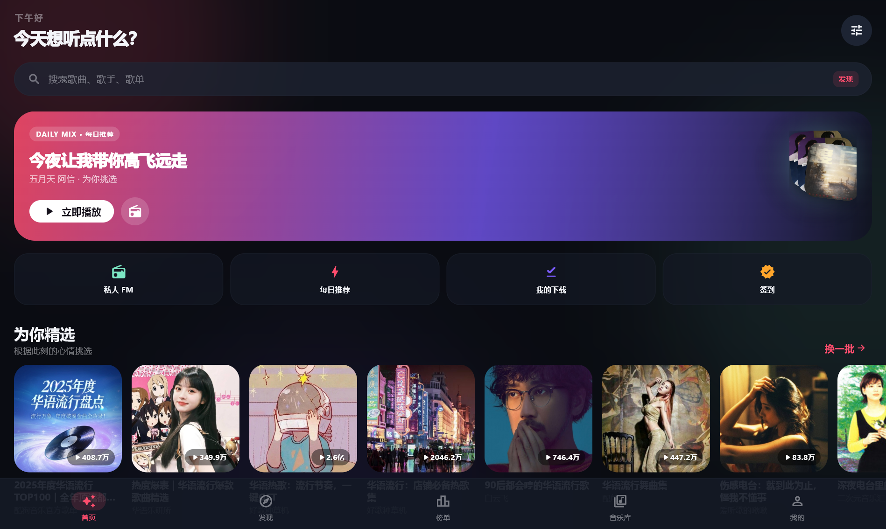
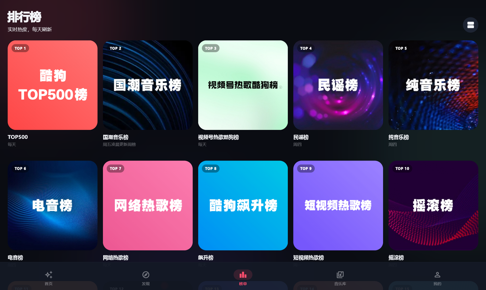
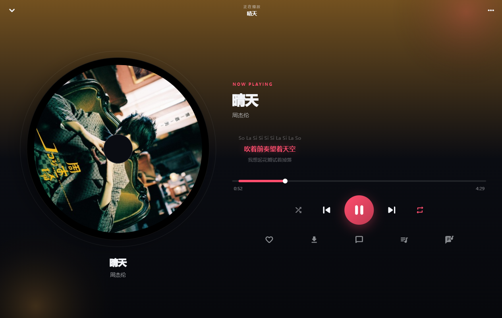
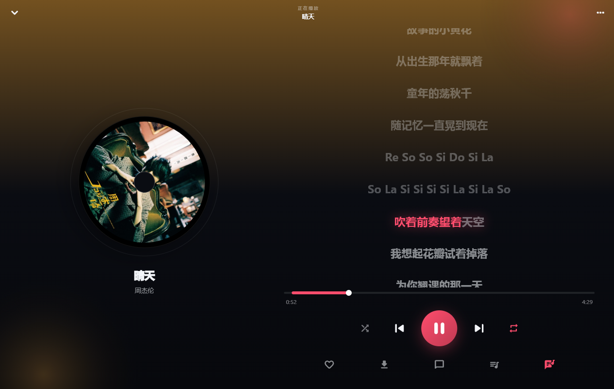
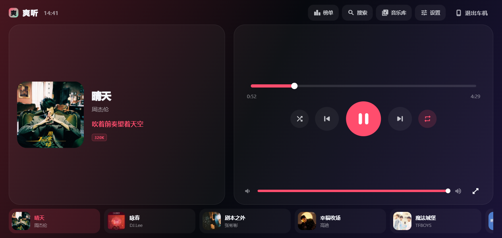
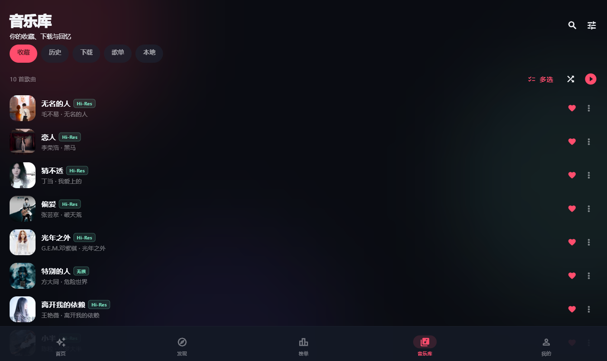
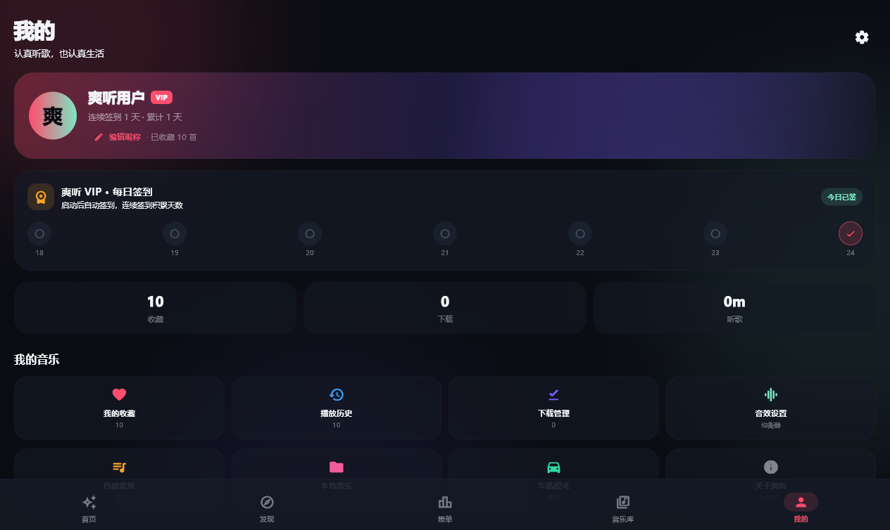
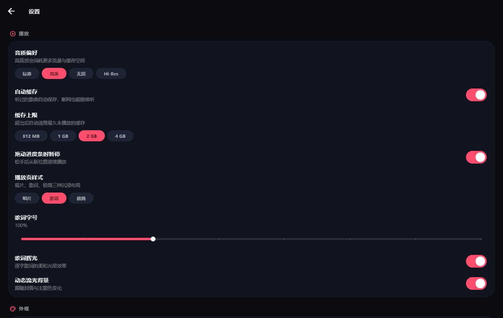

# 爽听 · ShuangTing

> 一款自己设计界面的 Flutter 音乐播放器。听过就缓存，断网也能听。

[](https://github.com/leey1994/shuangting/releases)
[](https://leey1994.github.io/shuangting/)

**下载**：[GitHub Releases](https://github.com/leey1994/shuangting/releases) · **主页**：[leey1994.github.io/shuangting](https://leey1994.github.io/shuangting/)



## 功能

- **在线曲库**：搜索、榜单、歌单、专辑、歌手、每日推荐、私人 FM、评论。
- **自动缓存**：听过的歌自动保存到本地，再次播放优先离线；支持 512MB–4GB 上限与 LRU 清理。
- **离线播放**：下载管理、本地音乐扫描、断网继续听。
- **每日签到**：启动自动完成「爽听 VIP」签到；登录酷狗账号后同步调用账号签到接口（扫码 / 验证码 / 密码三种方式，扫码为主推；Cookie 导入为高级选项）。
- **逐字歌词**：KRC 解码 + 卡拉 OK 高亮，支持歌词微调、字号、辉光。
- **三种播放页**：唱片、歌词、极简；动态流光背景随封面取色。
- **车机模式**：横屏大按钮布局，宽屏自动进入，也可手动切换。
- **桌面歌词**：Windows 下把窗口变成置顶歌词条；局域网共享当前缓存音频。
- **自动更新**：读取 GitHub Releases，Android 下载 arm64 APK 安装，Windows 下载 zip 后替换重启。
- **外观**：6 套主题色、深色/浅色/跟随系统/纯黑、Material 3。

## 截图

| 发现 | 榜单 | 播放 |
| --- | --- | --- |
|  |  |  |

| 歌单 | 歌词 | 车机 |
| --- | --- | --- |
|  |  |  |

| 音乐库 | 我的 | 设置 |
| --- | --- | --- |
|  |  |  |

更多见 [`docs/screenshots`](docs/screenshots)。

## 构建

```bash
flutter pub get

# Android（arm64 / arm / x64 分包）
flutter build apk --release --split-per-abi

# Windows
flutter build windows --release
```

Android 正式签名读取 `android/key.properties`（已被 `.gitignore` 忽略）。仓库不包含私钥；
CI 从 Secrets 还原：`ANDROID_KEYSTORE_BASE64`、`ANDROID_KEYSTORE_PASSWORD`、
`ANDROID_KEY_ALIAS`、`ANDROID_KEY_PASSWORD`。缺少时回退到 debug 签名。

## 发布流程

推送到 `main` 后，`.github/workflows/release.yml` 会：

1. 读取 `pubspec.yaml` 版本；若该版本 tag 已存在则自动递增 patch 并提交。
2. 构建 Android 分 ABI APK 与 Windows zip，按 `*-arm64*.apk` / `*windows*.zip` 命名。
3. 创建 GitHub Release，正文取自 `CHANGELOG.md` 对应版本段落。
4. 同步部署 `docs/` 到 GitHub Pages。

应用内「检查更新」只读取 `releases/latest`，所以资产命名不要改。

## 技术栈

Flutter 3.47 · Provider · just_audio（Android 后台通知 / Windows media_kit）· 酷狗公开 Web 接口。

```
lib/
  core/      主题、格式化、歌词解析
  data/      模型、接口、缓存、设置与曲库存储、更新
  player/    播放控制器
  ui/        页面与通用组件
```

## 说明

本项目用于 Flutter 学习与个人使用，音频与歌词来自酷狗音乐公开接口，版权归原作者与平台所有。
请勿用于商业分发。
